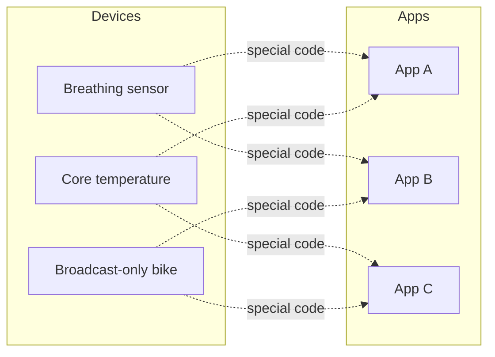
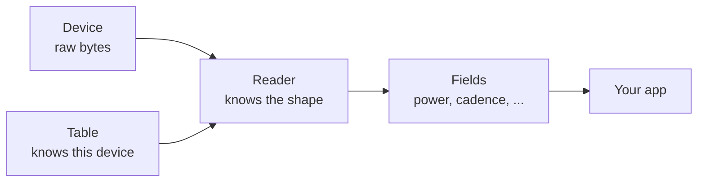
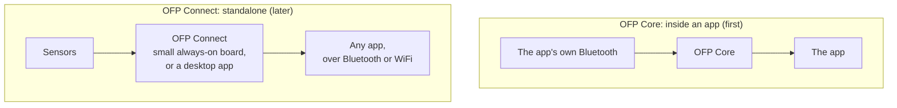
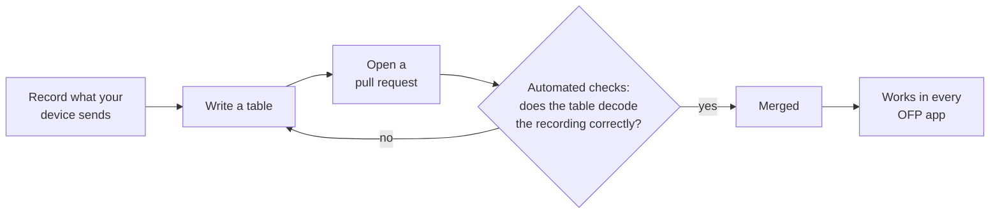

# Open Fitness Protocol (OFP)

**One open way for any fitness device to talk to any fitness app — with rules that live in a git
repo, not in a committee.**

> **Status: early design.** There is nothing to install yet. This page says what we are building
> and why. The details are in the [design document](docs/design.md), and all of it can still change.

---

## The problem

Fitness apps and fitness devices talk over Bluetooth. A few things are standardized: heart rate,
power, and smart trainers (a standard called FTMS). Those standards are good, but they are frozen.
Changing one takes a committee and years.

Meanwhile, people keep inventing new sensors: breathing, core body temperature, muscle oxygen,
bikes that simply broadcast their numbers. None of these fit the old standards, so every maker
invents a private format.

Then every app has to write special code for every device.



Most of those lines never get written. Small apps cannot keep up, and a new sensor only works in
the one or two apps its maker managed to convince.

## The goal

Put one open piece in the middle.


- **An app supports OFP once.** After that, every device OFP understands just works, including
  devices that did not exist when the app was released.
- **A device is added once.** Someone describes it in a small file, and it works in every app that
  supports OFP.
- **Nobody waits for permission.** Want a new measurement, such as torque per repetition? Open a
  pull request.

## Our exact goals

1. **Simple for riders.** Open the app, tap "Other sensors", pick the device. No settings, no
   jargon.
2. **Simple for app developers.** Add one library. It gives your app a single stream of named
   values: power, cadence, breathing rate, whatever the device has. The library contains no
   Bluetooth code of its own, so it fits beside what you already have.
3. **Simple for contributors.** Most devices are added with a **table**: a short data file that
   says "these bytes mean power, these mean cadence". No programming is needed for the common
   cases.
4. **Stable forever.** Once a value is official, its meaning never changes. Automated checks in
   this repo enforce that. An app written today keeps working.
5. **Fast to grow.** Experimental values and devices can be added in days. They become official
   once they are proven on real hardware.
6. **Open.** The rules are in this repo, in public. Anyone can read them, propose a change, or
   build their own version.
7. **Your install, your choice.** You can load your own plugin from a URL, without asking anyone.

## What we are not doing

- **Not replacing the existing standards.** OFP reads heart rate, power and FTMS data, and adds to
  them.
- **Not controlling trainers** (for now). Setting a target power or resistance stays with FTMS and
  with projects like QZ. The design leaves room for it later.
- **Not hosting device unlocks.** The official collection only decodes what a device sends openly.

## How it works

Four small ideas.



| Idea | What it is | Who writes it |
|---|---|---|
| **Field** | One named value with a unit, such as "power, watts" | Anyone, by pull request |
| **Reader** | Code that understands one *way* devices send data, for example "the numbers are in the Bluetooth broadcast" | The core team. There are only a few |
| **Table** | A small data file that tells a reader about one specific device | Anyone, by pull request |
| **Output** | One standard stream that describes its values and then sends them | Built in |

A table could look something like this (an illustration; the real syntax is not decided yet):

```yaml
device: Keiser M3i
reader: broadcast
match:
  name_starts_with: "M3"
only_when: byte[2] == 0          # real-time packets only
pick_one_by: byte[3]             # the bike number, so you can choose yours
zero_after_silence: 3s
fields:
  cadence:    u16le[4] / 10      # rpm
  heart_rate: u16le[6] / 10      # bpm
  power:      u16le[8]           # watts
  gear:       byte[16]
```

That is the whole "driver" for that bike.

## Where it runs



- **OFP Core** is the library an app embeds. It has no Bluetooth code of its own.
- **OFP Connect** is Core with its own radio. Over WiFi, one Connect can serve many devices to
  several apps at once, for example a whole room of bikes.

The same core runs in both, so a table behaves the same everywhere.

## Contributing

We want contributors, and we want it to be easy. You do not need to be a Bluetooth expert.

**Vibe coders are welcome.** If you built your table with Claude, Fable or any other AI assistant,
great. Say so in your pull request and stand behind it. Every contribution is checked the same way:
against a real recording from the real device. If the numbers come out right, it does not matter
who, or what, typed it.



Ways to help, from easiest to hardest:

- **Tell us about a device** you wish worked everywhere.
- **Add a table** for a device you own.
- **Confirm someone else's table** on your own device. A second confirmation is what moves a table
  from "submitted" to "confirmed".
- **Propose a field** for a measurement that does not exist yet.
- **Request a reader** when a device sends data in a way no existing reader understands.
- **Help build the core** (Rust).

While the project is in the design stage, the most useful contribution is feedback on the
[design document](docs/design.md): what is unclear, what is missing, and which device you would
want first.

## The rules, briefly

- Official values never change meaning. New ones can always be added.
- The official collection holds tables only, never code.
- Every table comes with a real recording, and the checks replay it.
- A table is your own work: made from your own recordings or the maker's public documentation,
  never copied from another project's code.
- A table is **submitted**, then **confirmed** by a second person, then **field-proven** when apps
  report that it works for real riders.
- You can load your own plugin from a URL on your own install. It is marked as unreviewed, and the
  project does not host or list such plugins. (Inside iPhone apps only tables work; a device that
  needs code reaches an iPhone through an OFP Connect.)

## Read more

- [Design document](docs/design.md): the full design, what comes later, and the open questions.

## Thanks

OFP stands on work others have done. [QZ](https://github.com/cagnulein/qdomyos-zwift) showed how
much riders want their equipment to work everywhere, and it remains the tool for controlling
trainers, which OFP does not do. [OpenBikeControl](https://openbikecontrol.org/) showed that a
small open protocol can win over apps and hardware makers. The design document lists more.

## Who is behind this, and the license

OFP was started and is maintained by [TrainerDay](https://trainerday.com), a training app for
indoor cycling. It is meant for every app and every device maker, and it is open to everyone.

- **License: Apache-2.0** for code, tables and documents, so any app can use it, open or closed.
  (The license file will be added before the first public release.)
- **No fees, ever.** No paid tiers and no certification fees. Nobody makes money from the protocol.
