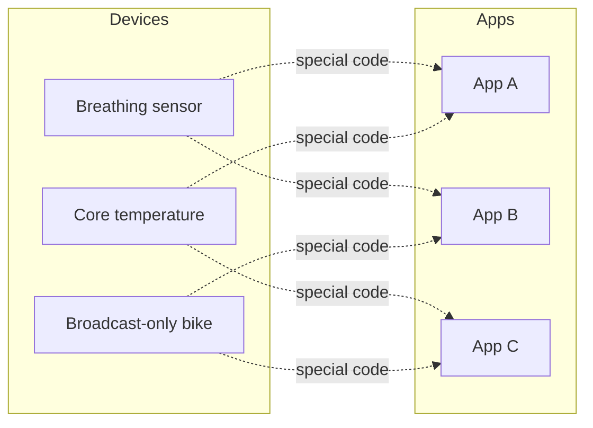
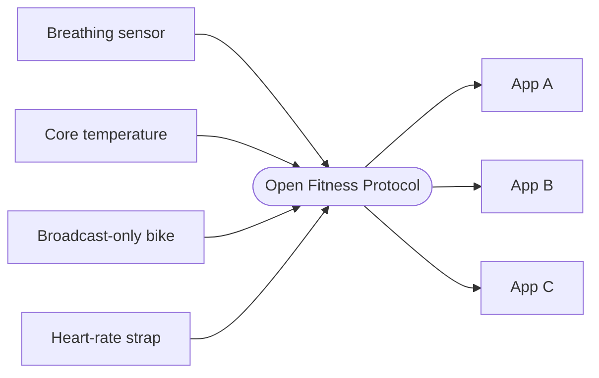
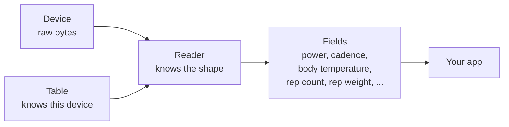
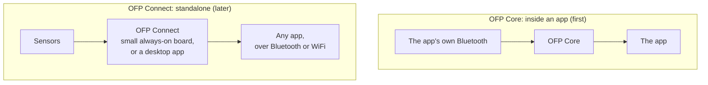
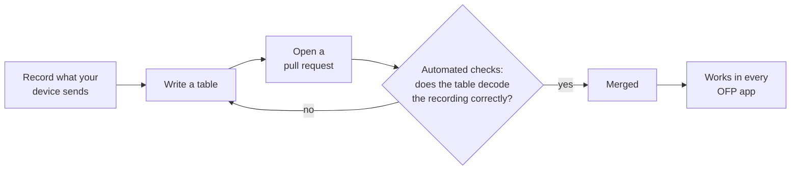

# Open Fitness Protocol (OFP)

**One open way for any fitness device to talk to any fitness app — with rules that live in a git
repo, not in a committee.**

> **Status: first version.** The core, the `ofp` command and one device (the Keiser M3i) work.
> Everything can still change until 1.0. The details are in the [design document](docs/design.md).

---

## The problem

Fitness apps and fitness devices talk over Bluetooth. A few things are standardized: heart rate,
power, and smart trainers (a standard called FTMS). Those standards are good, but they are frozen.
Changing one takes a committee and years.

Meanwhile, people keep inventing new sensors: breathing, core body temperature, muscle oxygen,
bikes that simply broadcast their numbers. None of these fit the old standards, so every maker
invents a private format.

Then every app has to write special code for every device.



Most of those lines never get written. Small apps cannot keep up, and a new sensor only works in
the one or two apps its maker managed to convince.

## The goal

Put one open piece in the middle.



- **An app supports OFP once.** After that, every device OFP understands just works, including
  devices that did not exist when the app was released.
- **A device is added once.** Someone describes it in a small file, and it works in every app that
  supports OFP.
- **Nobody waits for permission.** Want a new measurement, such as torque per repetition? Open a
  pull request.

## Our exact goals

1. **Simple for riders.** Open the app, tap "Other sensors", pick the device. No settings, no
   jargon.
2. **Simple for app developers.** Add one library and about twenty lines. It gives your app a
   single stream of named values: power and cadence, but also body temperature, breathing rate,
   rep count, rep weight: whatever the device has. The library contains no Bluetooth code of its
   own, so it fits beside what you already have.
3. **Simple for contributors.** Most devices are added with a **table**: a short data file that
   says "these bytes mean power, these mean cadence". No programming is needed for the common
   cases.
4. **Stable forever.** Once a value is official, its meaning never changes. Automated checks in
   this repo enforce that. An app written today keeps working.
5. **Fast to grow.** Experimental values and devices can be added in days. They become official
   once they are proven on real hardware.
6. **Open.** The rules are in this repo, in public. Anyone can read them, propose a change, or
   build their own version.
7. **Your install, your choice.** You can load your own plugin from a URL, without asking anyone.

## What we are not doing

- **Not replacing the existing standards.** OFP reads heart rate, power and FTMS data, and adds to
  them.
- **Not controlling trainers** (for now). Setting a target power or resistance stays with FTMS and
  with projects like QZ. The design leaves room for it later.
- **Not hosting device unlocks.** The official collection only decodes what a device sends openly.

## How it works

Four small ideas.



| Idea | What it is | Who writes it |
|---|---|---|
| **Field** | One named value with a unit: "power, watts", but just as well "body temperature, °C", "rep count" or "rep weight, kg". New kinds of measurement are the point | Anyone, by pull request |
| **Reader** | Code that understands one *way* devices send data, for example "the numbers are in the Bluetooth broadcast" | The core team. There are only a few |
| **Table** | A small data file that tells a reader about one specific device | Anyone, by pull request |
| **Output** | One standard stream that describes its values and then sends them | Built in |

This is the real table for the Keiser M3i, shortened
([the full file](registry/tables/keiser-m3i.yaml)):

```yaml
id: keiser-m3i
name: Keiser M3i
reader: broadcast
match:
  - manufacturer_id: 0x0102
    min_length: 17
only_when: u8[2] == 0            # live packets only
instance:                        # the bike number, so you can choose yours
  label: bike
  value: u8[3]
stale_after_ms: 3000             # after 3 s of silence, power and cadence read as zero
fields:
  power: u16le[8]                # watts
  cadence: u16le[4] / 10         # rpm
  heart_rate: u16le[6] / 10      # bpm
  gear:
    value: u8[16]
    only_when: u8[1] >= 0x21     # newer builds only
```

That is the whole "driver" for that bike.

## Where it runs



- **OFP Core** is the library an app embeds. It has no Bluetooth code of its own.
- **OFP Connect** is Core with its own radio. Over WiFi, one Connect can serve many devices to
  several apps at once, for example a whole room of bikes.

The same core runs in both, so a table behaves the same everywhere.

## Add OFP to your app: about twenty lines

**Add the library, wire it up once, and every device that gets a table works in your app the day
the table is merged.** Tables are data, not code, so a new device reaches an app you shipped a
year ago without an update, on iPhone too.

OFP has no Bluetooth of its own. It listens through your app's Bluetooth, so there are four small
things to connect:

1. **Initialize, and say what you already read.** Pass the Bluetooth services your app handles by
   itself (Heart Rate, Cycling Power, FTMS, …). This is a list of services, not of device models.
   OFP offers only what is not on it.
2. **Give it the full scan.** Every advertisement your scanner hears, before your own filtering: a
   bike that only broadcasts has no name or service your filter would keep.
3. **Hook into the results.** The devices OFP recognises go into your existing device list, and
   their readings come back in the shape your app already uses.
4. **Say when the rider picks one.** Your Connect button tells OFP "use this source" (and the same
   for disconnect) instead of trying a normal Bluetooth connection.

What your riders see:

- A device only OFP can read appears like any other: a broadcast-only bike is simply that bike.
- A device you already read that also has something of its own appears a second time as
  **"<device> Extras"** (for example "Polar H10 Extras"), carrying only what the standards have no
  place for. Your own handling of the device does not change.

Three things to know before you count the lines:

- **A broadcast device's data is the scan.** While one is in use your app must keep scanning, with
  repeats. If your app stops scanning once its devices are connected, that is the part that takes
  more than a few lines.
- **New kinds of values need one generic tile.** Power, cadence, heart rate and speed fit the
  places your app already has. A value it has never heard of (body temperature, rep count)
  arrives as a generic event with its name, unit and range; show and record that once, and every
  future field works too.
- **"Every device" means every device a table can describe.** Today: devices that send their
  numbers in their Bluetooth broadcast. Devices you connect to that simply notify come next.
  Devices that need a handshake, encryption or real code are not tables.

For a JavaScript app the four hooks are a small package, [`packages/ofp-js`](packages/ofp-js), and
there are two worked examples of a real integration in [`docs/integrating.md`](docs/integrating.md):

```js
const ofp = new Ofp({ engine, bundle, iRead: ['180d', '1818', '1826'], on: { device, values, inUse, lost } })
scanner.on('advertisement', (a) => ofp.advertisement(a))   // every one, unfiltered
ofp.use(id)                                                // the rider picked it
```

Status: two apps use it, both unreleased branches of TrainerDay's own: the desktop app (Electron,
the core as WebAssembly) and the Android app (React Native, where there is no WebAssembly, so the
same core runs as plain JavaScript). In both, the wiring is one small file. What works today is
broadcast devices that fill the usual places (power, cadence). The core can also read devices that
are connected to, and the Studio uses that; the two apps do not yet. The list of services is passed
in but not acted on, and the "Extras" devices are designed, not built.
The [design document](docs/design.md) has the details.

## Add your own device: a vibecoder-first project

**You own a device no app supports? You can add it yourself, with an AI assistant doing the
technical part.** You do not need to know Bluetooth or how to program. You need the device, a
computer, and Claude Code (or another assistant that can run commands). Not a vibecoder yourself?
Find a friend who is and sit down together for a quarter of an hour.

What you do is the part only a person can do: **use the device and say what its own display
shows.** The assistant does the rest, and a real recording of your device is the judge of whether
it got it right.

### What to tell your assistant

Clone this repo, open it in your assistant, and paste this:

```text
I want to add my <device name> to the Open Fitness Protocol registry. Work in this repo.

1. Read AGENTS.md first and follow it exactly. It has the rules for what may be added.
2. Build the tool (cargo build --release) and start the Studio: target/release/ofp studio
   Tell me when the page is open. I will do everything in that page that needs the device.
3. Ask me to pick my device in the page and press Record. Then ask me to use the device at two or
   three different efforts and to type what its own display shows each time (for example
   power=150 cadence=82). Do not invent these numbers: they come from me.
4. Check whether the registry already knows this device (GET /api/similar). If it does, extend
   that table. Only add a new one if nothing decodes the device.
5. Find which bytes are which (POST /api/solve, POST /api/series), reuse the fields in
   registry/fields, and write the table (POST /api/table/design). Add a new field only for a
   measurement that has none.
6. Check it (POST /api/table/check). Explain in plain words anything that does not pass.
7. Ask me to open the Live step and confirm each number against the device's display.
8. When everything passes, I press Save. Then run `ofp check`, and prepare a pull request with
   the table and the capture, signed off (git commit -s). Say in the pull request that an AI
   assistant helped.
```

The rules the assistant follows are in [AGENTS.md](AGENTS.md); the Studio serves the same text to
it. The checks decide the same way for everyone: if the recording decodes to the numbers you
noted and confirmed, it is right, whoever or whatever typed the table.

### Where your device then works

In every app that includes OFP, with no change to that app. Today that is an unreleased branch of
the TrainerDay desktop app; the project is new. Tables can be written for devices that send their numbers in
their Bluetooth broadcast and for devices you connect to that simply notify. In the two apps, only
the broadcast kind is wired in so far.

## Devices in the registry

| Device | How it is read | State |
|---|---|---|
| Keiser M3i indoor bike | broadcast | checked against a real ride |
| CORE body temperature sensor | broadcast (core temperature) | **draft**, from the maker's published notes; not tried on a sensor |
| CORE body temperature sensor | connected (core and skin temperature, heart rate, heat strain) | **draft**, from the maker's published specification |
| Tymewear VitalPro breathing sensor | connected (breathing rate, tidal volume, ventilation) | **draft**, from others' published findings ([facts](registry/tables/tymewear-vitalpro.spec.md)) |

Own one of the drafts' devices? Run `npm start`, pick the device, open **Live**, and say for each value
whether it is right. That is what turns a draft into a verified table. If something is wrong, the
recording you download holds what an assistant needs to fix it.

## Contributing

We want contributors, and we want it to be easy. You do not need to be a Bluetooth expert.

**Vibe coders are welcome.** If you built your table with Claude, Fable or any other AI assistant,
great. Say so in your pull request and stand behind it. Every contribution is checked the same way:
against a real recording from the real device. If the numbers come out right, it does not matter
who, or what, typed it.



Ways to help, from easiest to hardest:

- **Tell us about a device** you wish worked everywhere.
- **Add a table** for a device you own.
- **Confirm someone else's table** on your own device. A second confirmation is what moves a table
  from "submitted" to "confirmed".
- **Propose a field** for a measurement that does not exist yet.
- **Tell us when a table cannot express a device** (the issue form "A table cannot express this device").
  That is how a new reader or a change to the core is asked for; a device is never added by patching the core.
- **Help build the core** (Rust), on a change that has been accepted that way.

The rules, for people and AI assistants: [`AGENTS.md`](AGENTS.md). How a pull request gets in:
[`CONTRIBUTING.md`](CONTRIBUTING.md).

### Try it

The quickest way to see it: download **OFP Studio** for Mac or Windows from
[openfitnessprotocol.org/download](https://openfitnessprotocol.org/download). From the repository: `npm start` (or
`cargo run --release -p ofp-cli -- studio`) builds the tool the first time and opens the Studio in your browser.
`npm run app` opens the same Studio in a window of its own, and `npm run app:build` makes a Mac app of it
(`docs/studio.md`, "The app").

You need [Rust](https://rustup.rs). The Bluetooth commands are tested on macOS so far; the library
they use also supports Windows and Linux.

```bash
cargo build --release          # the command is target/release/ofp
ofp studio                     # the page: record, find the bytes, confirm, save
ofp check                      # what every pull request must pass
ofp scan                       # devices in range, with how often each one is heard
ofp live                       # decoded values of a device a table knows, as large numbers
```

### Add a device by hand

The Studio (`ofp studio`) does these steps in a page. The same from the terminal:

1. **Scan.** `ofp scan` lists what is in range. Note your device's name.
2. **Record, with notes.** `ofp record "<name>"` saves everything the device sends into a capture
   file (add `--connect` for a device that must be connected to). While it records, type what the
   device's own display shows, for example `power=150 cadence=82`, and press Enter. Do that at a
   few steady moments. `ofp inspect <file>` then shows which bytes change.
3. **Write the table**: `registry/tables/<your-device>.yaml`, with the capture next to it as
   `<your-device>.capture.jsonl`. `ofp check` replays the capture and compares the table's values
   with your notes.
4. **Watch it live and confirm.** `ofp live` shows each value as the table decodes it. Press a
   value's number and say whether the device's display shows the same. Your answers are saved in
   the capture; from then on the checks hold the table to them.
5. **Open a pull request** with the table and the confirmed capture.

The capture file is described in [docs/capture-format.md](docs/capture-format.md), the table
language in the [design document](docs/design.md#the-table-language).

## The rules, briefly

- Official values never change meaning. New ones can always be added.
- The official collection holds tables only, never code.
- Every table comes with a real recording, and the checks replay it.
- A table is your own work: made from your own recordings or the maker's public documentation,
  never copied from another project's code.
- A table is **submitted**, then **confirmed** by a second person, then **field-proven** when apps
  report that it works for real riders.
- You can load your own plugin from a URL on your own install. It is marked as unreviewed, and the
  project does not host or list such plugins. (Inside iPhone apps only tables work; a device that
  needs code reaches an iPhone through an OFP Connect.)

## Read more

- [Design document](docs/design.md): the full design, what comes later, and the open questions.
- [OFP Studio](docs/studio.md): the page for adding and testing a device, and its API.
- [AGENTS.md](AGENTS.md): the rules for adding to the registry, for people and AI assistants.
- [Adding OFP to an app](docs/integrating.md): the four hooks, two worked examples, and a prompt for an assistant.
- [Capture format](docs/capture-format.md): the file a recording is saved in.
- [`crates/ofp-ffi`](crates/ofp-ffi/src/lib.rs): the five functions an app calls.

## Thanks

OFP stands on work others have done. [QZ](https://github.com/cagnulein/qdomyos-zwift) showed how
much riders want their equipment to work everywhere, and it remains the tool for controlling
trainers, which OFP does not do. [OpenBikeControl](https://openbikecontrol.org/) showed that a
small open protocol can win over apps and hardware makers. The design document lists more.

## Who is behind this, and the license

OFP was started and is maintained by [TrainerDay](https://trainerday.com), a training app for
indoor cycling. It is meant for every app and every device maker, and it is open to everyone.

**TrainerDay does not intend to own this forever.** Once OFP has contributors and other apps using
it, we intend to hand its stewardship, including the name, to the community or to a neutral body.

- **License: [Apache-2.0](LICENSE)** for code, tables and documents, so any app can use it, open
  or closed.
- **The names** "Open Fitness Protocol" and "OFP" are trademarks of TrainerDay Inc, kept only so that
  "OFP compatible" means the same thing everywhere: [`TRADEMARKS.md`](TRADEMARKS.md). Copyright:
  [`NOTICE`](NOTICE).
- **No fees, ever.** No paid tiers and no certification fees. Nobody makes money from the protocol.
